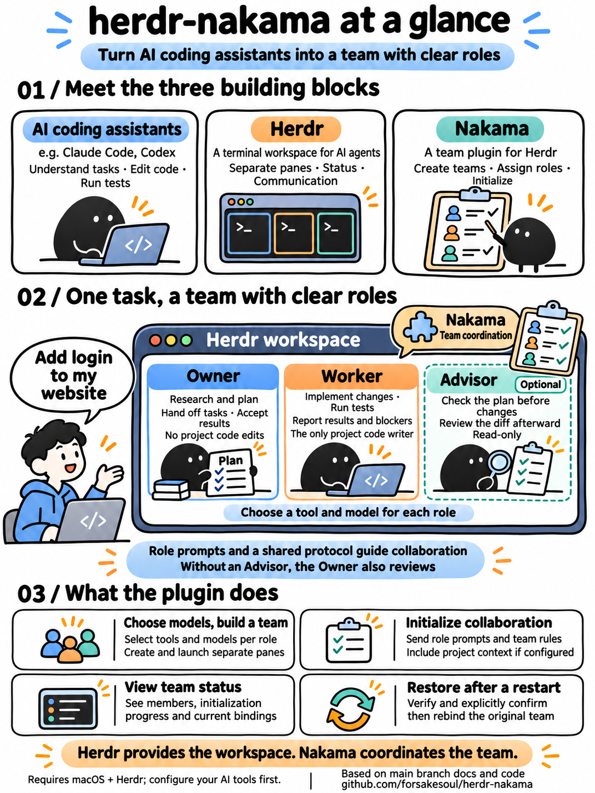

# Nakama

[English](README.md) | [简体中文](README.zh-CN.md) | 日本語

[Herdr](https://herdr.dev) 上で Owner / Worker / Advisor の 3 ロールからなるコーディングエージェントのチームを作成・初期化・復元する **Herdr ネイティブプラグイン**です（Go 実装、標準ライブラリのみ使用）。

https://github.com/user-attachments/assets/4b663eaa-346a-43d5-8933-d254a7285315

▶ 85 秒の使い方紹介（英語音声）· [中文版](https://github.com/user-attachments/assets/25ce3f28-7fe1-4619-8731-c8773cf14a4f) · [プロジェクトページ](https://forsakesoul.github.io/herdr-nakama/)

## 図でわかる Nakama（英語版）



各ロールは Herdr の独立した pane で動作し、役割分担はプロンプトと共有の協働プロトコルで定められます。具体的な操作と復元条件は以下を参照してください。

## なぜ「Nakama」なのか

*Nakama*（仲間）は『ONE PIECE』でルフィが船員を呼ぶ言葉です。部下でも道具でもなく、それぞれが航海の一部を担い、互いに背中を預け合う仲間。それがこのプラグインの作るチームの形です：

- **Owner：船長。** 航路を決めます。調査し、引き継ぎパッケージを確定し、結果を受け入れます。プロジェクトのコードは書きません。
- **Worker：手を動かす船員。** コードを変更する唯一の存在で、完了・ブロック・コンテキスト不足のときに自分から報告します。
- **Advisor：航海士。** 任意。方針を検証し、diff を独立にレビューします。

仲間はそれぞれ自分の pane と自分のエンジンで航海し、共有プロトコルがその会話の仕方です。確定した引き継ぎ、NOTICE、誰も他人の代わりに答えないこと。嵐（コンピューターや Herdr の再起動）で船員が散り散りになっても、`nakama rebind` がビブルカードのように一人ひとりを見つけ出します。新しいチームではなく、元の一味のままで。

この名前はオマージュであり、提携を示すものではありません。本プロジェクトは『ONE PIECE』、尾田栄一郎氏、集英社、東映アニメーションとは一切関係がありません。

## クイックスタート

```sh
# 1. インストール（manifest のビルドが実行されます）。ローカル開発時は：go build … && herdr plugin link "$PWD" --enabled
herdr plugin install forsakesoul/herdr-nakama
# 2. 非公開設定：存在しない場合のみ config.example.json から生成（0600）し、必要に応じて pi_provider / cc_env_file を記入（非公開、コミット禁止）
cfg="$(herdr plugin config-dir forsakesoul.nakama)/config.json"
[ -e "$cfg" ] || (umask 077 && mkdir -p "${cfg%/*}" && curl -fsSL https://raw.githubusercontent.com/forsakesoul/herdr-nakama/main/config.example.json -o "$cfg.tmp" && mv "$cfg.tmp" "$cfg")
# 3. キーバインドを ~/.config/herdr/config.toml に追記して設定を再読み込み
herdr server reload-config
```

キーバインド例（`config.toml`）：

```toml
[[keys.command]]
key = "prefix+u"
type = "plugin_action"
command = "forsakesoul.nakama.pick"
description = "nakama: エンジンを選んで現在の pane をアンカーにチームを作成"

[[keys.command]]
key = "prefix+i"
type = "plugin_action"
command = "forsakesoul.nakama.init"
description = "nakama: init（現在のアンカーのチームを初期化）"
```

対象 pane で `prefix+u` を押すとエンジン選択画面（overlay）が開きます。Owner / Worker / Advisor を順に選び（Enter で既定値。`engine_map` の短縮名か完全な `<launcher>/<model>[:effort]` を入力でき、Advisor は `none` も可）、概要を確認すると、キーを押した時点でフォーカスされていた pane をアンカーとしてチームを作成します。`Ctrl-C` でキャンセル（確認前は何も作成されません）。アンカーにすでにチームがある場合は既存チームと各ロールの固定済みエンジンのみ表示します——同じアンカーでモデルは変更できません。新しいモデルを使う場合は新しい pane でチームを作成してください。選択画面は新規作成専用です。確認中にその pane にチーム（作りかけを含む）が現れた場合も拒否し、復旧や引き継ぎはしません。作成中にシグナルを受けると、実行中の操作を永続化してから非ゼロで終了し、結果画面には留まりません。エージェントの起動を確認したら `prefix+i` で初期化します。結果は `herdr plugin action invoke status --plugin forsakesoul.nakama` または `herdr plugin log list --plugin forsakesoul.nakama` で確認できます。

> `up` アクションは従来の動作（`default_profile` に従ってチームを作成、または CLI で `--owner/--worker/--advisor` を指定）を維持し、作りかけのチームの再開にも使います。シェルからの `herdr plugin action invoke up/init/pick` は呼び出し元の pane を渡さず、UI で現在フォーカスされている pane をアンカーにするため、`pick` / `up` / `init` はキーバインドで（または対象 pane にフォーカスがある状態で）実行してください。

## 必要環境

- macOS
- Go ツールチェーン（バイナリのビルド用。go.mod は 1.24 を宣言）、`git`
- Ruby / YAML / jq は不要（共有プロトコルとロールプロンプトは `prompts/<lang>/*.md`）

## ディレクトリ構成

```
herdr-plugin.toml       manifest（actions: up / init / status / rebind / pick、pane: picker）
cmd/nakama/      実装（package main：config / engine / state / lock / identity / prompts / team …）
bin/nakama       ビルド成果物（コミットしない。下記参照）
prompts/{en,zh,ja}/      言語ごとの protocol.md + owner.md / worker.md / advisor.md
config.example.json     設定例（個人の provider / 認証情報は含まない）
cmd/nakama/*_test.go  go test（テストバイナリ自身が偽の herdr として argv を JSON 行で記録）
tests/fixtures/         実際の Herdr 0.9.3 の出力（匿名化済み）
```

## ビルド、インストール / リンク

manifest の `[[build]]` は `herdr plugin install` 時のみ実行されます。`herdr plugin link` は登録のみで**ビルドしません**（Herdr 0.9.3 `plugin.rs`）。ローカルでリンクする前に同じビルドコマンドを手動で実行してください：

```sh
go build -trimpath -o bin/nakama ./cmd/nakama
herdr plugin link /path/to/nakama
herdr plugin action list --plugin forsakesoul.nakama
```

`up` / `init` には pane コンテキスト（`contexts = ["pane"]`）が必要です。`status` はグローバルかつ読み取り専用です。

## 設定

設定ディレクトリ：`$HERDR_PLUGIN_CONFIG_DIR`（Herdr が注入）、なければ `${XDG_CONFIG_HOME:-$HOME/.config}/nakama`。
ファイル：`config.json`。**実際の provider / パス / 認証情報をリポジトリにコミットしないでください。**

```json
{
  "default_profile": {
    "owner": "sol",
    "worker": "ds",
    "advisor": "none",
    "engine_map": { "sol": "codex/<model>:high", "ds": { "owner": "pi/<model>:low", "worker": "pi/<model>:low", "advisor": "pi/<model>:high" } },
    "cc_env_file": ""
  },
  "projects": {
    "<repo-name>": { "prefix": "<short>", "context_file": "/abs/project-context.md", "trigger": ";xx.ctx" }
  }
}
```

- **言語**：CLI の出力とエージェントのプロンプトは `NAKAMA_LANG=en|zh|ja` で選び、未設定なら `LC_ALL` / `LC_MESSAGES` / `LANG`（`zh*`、`ja*`）の順に参照し、それ以外は英語です。この変数はプラグインのプロセスが読むため、Herdr を起動する環境で設定してください。`up` と `init` では同じ言語を使ってください。言語ごとにプロンプトが異なるため、途中で切り替えると protocol ハッシュのずれとして拒否されます。
- 優先順位：CLI > `default_profile` > 組み込みの中立な既定値（設定がなければエラー。個人の provider は組み込まない）。
- エンジン記法：`<launcher>/<model>[:effort]`、または `engine_map` の短縮名。
- `cc` でモデルを省略すると `claude-opus-5-5` + `medium`（`cc --model claude-opus-5-5 --effort medium`）。モデルを指定し effort を省略した場合は `--effort` を渡さず、Claude 自身の既定値に任せます。
- **provider**：`pi` ロールの provider は `default_profile.pi_provider` から取得します（非公開、コミット禁止）。未設定なら `up` は split の前に拒否します。
- **`ccenv` ランチャー**：pane 内で env ファイルを `source`（例：`ANTHROPIC_BASE_URL` などで自前のゲートウェイを指定）してから `cc --model <model>` を起動します。`model` は必須で effort は受け付けません。`default_profile.cc_env_file` はこのマシン上の通常の読み取り可能なファイルを指す必要があり、`up` の前に検査されます（`-f` かつ `-r`。内容は読まず表示もしない）。ディレクトリは拒否します。source に失敗した場合（非ゼロの `return` を含む）は非ゼロのまま `cc` を起動しません。パスは**該当 pane のコマンド文字列**に現れます（パスは秘密情報ではありません）が、env ファイルの**内容**がコマンド / 状態 / プロンプト / ログに入ることはありません。
- `projects` テーブルはコンテキストファイルのパスを**参照**するだけで、本文はコピーしません。ファイルが存在しない / 読めない場合 `init` は停止します。
- `init` の前に `protocol.md` とコンテキストファイルの現在の sha256 が記録値と一致することを確認します。ずれていれば拒否し（新しいチームを `up` するよう案内）、ハッシュを自動更新することはありません。

## 使い方

```sh
nakama up [--owner E] [--worker E] [--advisor E|none] [--pane P] [--cwd C]
nakama init --team <id>
nakama status [--team <id>]
nakama rebind --team <id> [--preflight | --discard-pending] [--confirm-session <role>=<session>]... [--confirm-anchor <terminal>]
```

- 新しいチーム名：`<プロジェクト短縮名 ≤8>_<12hex>`、一致するプロジェクトがなければ `task_`。サフィックスはナノ秒タイムスタンプと 6 バイトの暗号学的乱数を混ぜ、SHA-256 の先頭 6 バイトから生成し、外部ツールが認識できる固定形式を保ちます。ロール名は `<prefix>_design/_execute/_advisor`、全長 ≤32。既存チームは元の名前を使い続けます。
- アンカーの pane/cwd は注入されたコンテキスト（`HERDR_PLUGIN_CONTEXT_JSON` / `HERDR_PANE_ID`）から取得し、`herdr pane get/current` で読み取り専用に検証します。**プラグインルートの `$PWD` をプロジェクトディレクトリとして使うことはなく**、特定できなければ拒否します。
- すべての Herdr 呼び出しは `HERDR_BIN_PATH`（既定 `herdr`）を経由し、argv は引数ごとに渡します。eval やシェル文字列の連結はしません。
- `split` は常に `--pane/--cwd/--no-focus` を明示します。
- 起動後にロールが認可 / 信頼ダイアログで止まった場合、`up` はその pane で認可されるのを待ちます。各ロールの 1 回の取得には待機上限 `NAKAMA_START_WAIT_SECONDS`（既定 600 秒）が 1 つだけあり、待機中は入力を送りません。
- `init` のアンカーはチームの任意のロール pane で構いません。ロール pane にフォーカスがある場合は pane から所属チームを探し、呼び出し元がまだそのチームの該当ロールインスタンスであることを先に検証します（読み取り専用。prompt/rename の前に拒否）。複数のチームに一致した場合はエラーとなり `--team` の指定が必要です。`up`/`pick` は引き続きアンカー pane のみで既存チームを判定します。

## 状態と安全性

- 状態：`$HERDR_PLUGIN_STATE_DIR/teams/<safe-id>.json`（既定 `${XDG_STATE_HOME:-$HOME/.local/state}/nakama`）。ディレクトリ 0700、ファイル 0600、同一ディレクトリの一時ファイル + `os.Rename` によるアトミック置換。JSON は解析するだけで実行はしません。必須フィールドの欠落 / null は常に不正とし、Go のゼロ値を有効値とみなしません。
- ロック：`mkdir` ロック（flock は使わない。プロセス終了時の自動解放は「残留ロックを自動で引き継がない」原則を壊すため）。ロック順は anchor → team に固定。新規チームは発見可能な状態を公開する前に team ロックを取得してトランザクション終了まで保持し、既存チームへのすべての書き込みは同じ team ロックを使います。**残留ロックは自動で引き継がず**、エラーで手動確認を促します。ロック内で状態と pending を読み直してから判断し、このプロセスが取得した完全なパスのみを解放します。
- インスタンス識別：各ロールの起動 / 検証が成功すると `terminal|pane|kind|session` を永続化します。`init` / 再入 / `rename` / `prompt` の前に `agent get` で再検証し、pane / 識別フィールドの欠落やずれがあれば拒否します。識別の比較は単一の実装で terminal/pane/kind/session を完全に比較します（session の空 ↔ 非空の変化もずれとみなす）。手動ランチャー（`cc`/`ccenv`/`pi`）は `rename` の前に pane の現在のインスタンスが起動時の観測と一致することを確認し、後から入った別のインスタンスを `rename` しません。`rename` 後は同じ基準（起動時の観測または固定済み identity）で完全なフィンガープリントを再確認し、通過して初めて固定して prompt を許可します（`rename` 自体は取り消せないため、ずれた場合も実行済みの 1 回の `rename` は残ります）。
- 副作用の順序：各 `split`/`pane run`/`rename`/`prompt` の前に `pending` を書き込み、戻った後に更新します。`split` が成功したら即座に pane を永続化します。再入時はまず検証し、`UNKNOWN` なら再送せず停止します。「起動前の `agent_pane_busy`」のみ有限回リトライします。
- `timeout`/`agent_prompt_stalled` となった初期化は「送信済み・未確認」として記録され、`status` が手動での `get/read` を案内します。
- 起動時の取得では、各観測（初回を含む）が `blocked`（認可 / 信頼ダイアログ）または `unknown` の場合、同じ待機予算内で再観測し、その状態を抜けてから固定します。`start` が `agent_not_ready`（名前は確保済み）を返した場合も同じ待機に入ります。予算は 1 回の取得あたり `NAKAMA_START_WAIT_SECONDS`（既定 600 秒）で、途中で `unknown`/`blocked` が切り替わってもリセットされません。タイムアウトは起動失敗として扱い、認可待ちのタイムアウトであることを示します。待機中は観測のみで入力は送らず、各ロールにつき 1 回だけ通知します。cc/ccenv/pi の待機時間は `NAKAMA_START_POLL_TRIES` の session ポーリング枠に含めません。
- `init` の `prompt` が `agent_blocked` を返した場合、入力は送信されていません。pending をクリアして非ゼロで終了するので、ダイアログを処理してから `prefix+i`（または `init`）を再実行してください。これは UNKNOWN ではありません。
- 手動ランチャー（cc/ccenv/pi）の session は、プロセスが認識された後に SessionStart フックによって報告されます。起動時の観測は同じ有限ポーリング（`NAKAMA_START_POLL_TRIES`）内で session が現れるのを待ってから永続化し、初回の固定で空 → 非空をずれと判定しないようにします。最後まで報告されなければ空として記録します。
- 固定時に session が空だったロール（codex は最初の prompt 後に session を報告）：`init` の再入時の再検証で、観測された非空の session を identity に一方向で補完できます（terminal/pane/kind は完全一致が必要）。補完後の変化はずれとみなします。この例外は inited 済みで stale でない再入ロールにのみ適用されます。stale になったロールは自動でクリアされず、手動対応（新しいチームを up）が必要です。既知の限界：補完前に同じターミナル・同じ kind の新しいインスタンスに置き換えられた場合は区別できません。
- SIGHUP/SIGINT/SIGTERM を受けると、ディスパッチのチェックポイントを通過済みの Herdr 操作 1 件は完了して永続化され、その後は新しい副作用を開始しません。コマンドは非ゼロで終了し、ロックは通常の終了経路で解放されます。SIGKILL は処理できず、残留ロックは「自動で引き継がない」原則に従いフェイルクローズするため、手動確認の上で削除が必要です。
- `up` の再入は `starting`（新たな書き込みが発生する）経路でのみ protocol/context のハッシュを確認します。launched/initialized 経路は Herdr への書き込みを追加せず、ハッシュは `init` が確認します。
- ユーザーの既存 pane を閉じたり改名したりせず、実行中の古いチームを引き継ぐこともありません。

## コンピューターまたは Herdr の再起動後にチームを復元する

**何が起きるか。** Herdr（またはコンピューター）の再起動後、各ロール pane の `pane_id` と kind は通常維持されますが、`terminal_id` はすべて変わります（アンカーも同様）。
タスク名はクリアされるか、外部ツール（Bridge）によって `<プロジェクト slug>-<terminal ダイジェスト>` に自動改名されることがあります。claude の会話は通常同じものが続き、codex の session は最初の prompt 後にのみ現れます。
この時 `status` ではロールが見えますが、`init` / `prompt` の terminal と名前のチェックが拒否するため、チームはランタイムから使えなくなります。

**手順。**
1. まず読み取り専用のプリフライト（書き込みゼロ）を実行：`nakama rebind --team <id> --preflight`。ロールとアンカーごとに `terminal 旧 → 新`、session とタスク名の差分を出力します。
2. 出力に従って確認引数を加えて実行：`nakama rebind --team <id> --confirm-anchor <新しいアンカーの terminal> [--confirm-session <role>=<session>]...`。
   - `--confirm-session` は記録された session が空のロール（例：最初の prompt 前に固定された codex）専用で、値は今回観測された非空の session と一致する必要があります。
   - `--confirm-anchor` は identity を持たないシェルアンカー専用で、値は今回観測された新しい terminal と一致する必要があります。
   - 記録された session が非空のロールは確認による上書きを受け付けず、観測値が記録と一致する必要があります。
3. 再バインド不要（識別と名前がすでに一致）の場合は `再バインド不要` を出力し、状態を書き込みません。繰り返し実行しても完全な no-op で、`team_rev` も監査記録も増えません。

**拒否条件（いずれも rename ゼロ、状態書き込みゼロ）。** チームが `initialized` でない、pending がある、いずれかのロールが stale または未初期化。pane が読めない。
pane の workspace/tab/cwd が記録と異なる。kind が変わった。観測された session が空、または記録と異なる。タスク名が空でも Bridge の正確な自動名でもない（他者が使用中の可能性）。
対象のタスク名が他の pane に使われている。確認値が観測と異なる、または確認不要なフィールドを指している。拒否時は候補の差分を出力するだけで、新しい identity として書き込むことはありません。

**意味は「受け入れ」であり「証明」ではない。** 同じ pane + 同じ kind + 非空の session は、ユーザーが「同じ会話が新しい terminal で再開した」ことを明示的に受け入れたことを示すだけで、同一プロセスや同一の認証情報を証明するものではありません。
CLI では Herdr サーバーの名前空間を証明できません。アンカーの根拠は `pane get` の workspace/tab/cwd の連続性と pane id です。

**実行と中断。** プリフライト通過後、まず完全な計画（旧 / 新の識別、改名ステップ）を `rebind_pending` として永続化し、ロールごとに：改名前に再読込 → `agent rename` → pane とタスク名の両方向で再検証、
各ステップの結果を永続化します。すべての再検証が通過して初めて、現在の identity とアンカーの terminal（および `pane_terminal`）を一括でコミットし、`team_rev` を 1 増やし、pending をクリアして監査記録を追加します。監査（`rebinds`）には操作 id、時刻、結果（`committed` または `discarded`）、確認方法、各ステップの旧 / 新の完全な identity（session の確認前後の値を含む）、アンカーの旧 / 新の terminal を記録し、アンカーが identity を持つ場合はその旧 / 新の完全な identity も記録します。出力の抜粋は記録しません。
`launch_identity` は起動履歴として残し、現在の検証には使いません。途中で失敗・シグナル・不明な結果が発生した場合は pending と完了済みステップを残して非ゼロで終了し、**盲目的なロールバックは行いません**。
実行前とコミット前にはチーム全体を再検証します：安定したチームの条件、計画された各ロールの pane コンテキスト（workspace/tab/cwd）と完全な識別、アンカーのコンテキストと識別（アンカーが変化していない場合も同様）。完了済みのステップも再検証し、改名を再送しないだけです。実行または再開を始める前に、現在の観測が計画上の新しい識別と一致している必要があり、まだ旧識別のままなら停止し（再プリフライトまたは待機）、新たな rename はゼロで、部分的に改名された結果を成功とはみなしません。ずれを検出したら新たな rename の前に停止し、計画と現在の identity を保持します。永続化された計画がチームの記録とフィールド間で矛盾する場合（ステップの欠落や重複、存在しないロール、旧識別の相違、未確認の session 変化など）は破損とみなし、実行もコミットも拒否し、既定値で補完しません。

**部分的な失敗後の手動確認。**
1. `herdr agent get <pane>` と `herdr agent get <name>` で各ロールの pane、terminal、kind、session、タスク名を確認します。
2. 照合を継続できる場合は、元の確認引数を付けて `rebind --team <id>` を再実行します（計画で確認済みの値のみ指定でき、異なれば拒否）。
3. 識別がもはや計画と一致しない場合（例：再度再起動した）は、`rebind --team <id> --discard-pending` で計画を破棄します。識別の記録は変わらず、完了済みの改名は Herdr に残ります。その後もう一度 `--preflight` してから実行してください。
   計画はコミット前に現在の identity を一切変更しないため、破棄は安全です。次のプリフライトは現在の観測に基づいて改めて判断します。

**Bridge との競合。** Herdr の rename には compare-and-swap の意味論がないため、読み取りと改名の間に Bridge が自動命名する可能性を数学的に排除できません。
ずれを検出したら停止して計画を保持します。プラグインは Bridge を追いかけたり変更したりしません。成功しても名前が永久に変わらないとは限らず、その後の `init` / `prompt` は引き続き厳格なルールで検査します。

**状態の互換性。** このバージョンは `schema_version: 2` を書き込み、`rebind_pending` と `rebinds`（監査）を追加します。旧バージョンは schema 1 のみ受け付け、2 を読むと拒否するため、
新しいフィールドを失った状態で上書きされることはありません。旧バージョンに戻す場合は、未完了の計画がないことを確認し、状態ファイルを自分で処理してください。schema 1 は引き続き読み込め、保存時に 2 へ更新されます。

**自動では行われないこと。** `init` と `up` は再バインドを行いません。`init` は「terminal または名前だけが変わった候補」を検出すると `明示的な rebind --team <id> が必要な可能性` を案内するだけで、
stale にせず状態も書き込みません。`status` は読み取り専用で、記録された pane に基づいて観測し、`binding=bound|candidate|unverified` を出力して、ライフサイクルの `status` とバインドの有効性を区別します。`bound` は現在のタスク名が記録されたロール名と一致することも要求し、他者の名前や空の場合は最大でも `unverified` です。`candidate` は候補（同じ pane と kind で terminal または名前が変化）にすぎず、`rebind` がプリフライトを通過する保証はないため、まず `--preflight` で確認してください。

## プロトコルの出典

`prompts/<lang>/{protocol,owner,worker,advisor}.md` は共有プロトコルとロール本文の唯一の正本で、実行時に直接読み込まれます。`protocol_version` は選択した言語の `protocol.md` の sha256 です。中国語が原文で、英語と日本語は翻訳です。同じ `<!-- … -->` マーカーを保つ必要があります（テストで検査）。下流でこれらのテンプレートを再利用する場合は、このディレクトリから同期し、出典バージョンを各自で検証してください。手動 Skill の許可はプロジェクトのコンテキストファイルまたは依頼内容に記述し、プロトコル自体は Skill の許可リストを持ちません。

アーキテクチャタスクでは、`architecture` Skill がインストールされていればロールごとに読み込み、なければ元の引き継ぎ契約で続行してギャップを明記します。プラグインは Skill のインストール、ロール分担の変更、チームの派生を行いません。テンプレートの変更は既存ロールのコンテキストを更新しません。初期化が完了していない古いチームは元のプロトコルハッシュのずれ検査で保護されたままで、状態をクリアして回避することはできません。

ユーザーがいずれかのロールにコンテキスト圧縮を求めた場合は、インストール済みの `long-task` Skill の自動圧縮分岐を使います。本プラグインは既存の責務、一時停止 / 再開の許可、リクエスト状態との接続ルールのみを保持します。バックグラウンド制御は呼び出し元自身のセッションのみを対象とし、未インストールまたは制御プレーンが未対応の場合は復旧情報を保持してギャップを報告します。

## テスト

```sh
gofmt -l .
go vet ./...
go test ./...
go build -trimpath -o bin/nakama ./cmd/nakama
```

フィクスチャ `tests/fixtures/agent_get.json` / `pane_get_shell.json` は実際の Herdr 0.9.3 の出力（匿名化済み）です。通常のシェル pane にも `terminal_id` があり、`agent get` の `agent` フィールドが kind、`agent_session.value` が session です。

`plugin_context_invoke.json` は実際の `plugin.action.invoke` 応答の `context` です（注入される `HERDR_PLUGIN_CONTEXT_JSON` と同値であることをソースで確認済み。サンプルは invoke 応答由来で、子プロセスの環境ではありません）。その `tab_label` / `focused_pane_agent` は UI のアクティブタブによるフィールド単位の上書きで、明示的に渡した tab/pane とは一致しないため、プログラムは `focused_pane_id` のみを使います。`agent_start.json` は実際の `up` のアクションログにある native `agent start` の stdout（匿名化済み）で、サンプルとして残しているだけで解析はしません。

## 既知の制限

- Herdr サーバーの名前空間は CLI から直接証明できません。アンカーの根拠は `pane get` の `terminal_id` の連続性（init 時 / 既存チームで比較）で代替しており、本 README はその境界を記載しています。
- `rebind` の改名と Bridge の自動命名の間には解消できない競合ウィンドウがあります（「コンピューターまたは Herdr の再起動後にチームを復元する」を参照）。ずれを検出したら停止して計画を保持します。
- `rebind` の Herdr 呼び出しは偽 herdr ハーネスでのみ検証しています。実際の Herdr 0.9.3 での `agent rename` の戻り値と `plugin action invoke` の引数渡しは、このバージョンではサンプリングしていません。
- 手動ランチャー（pi/cc/ccenv）の初回固定には「split 時に記録した terminal_id == 最初の agent get の terminal_id」+「kind が期待する種類と一致」+「インスタンスが他者に命名されていない」が必要で、いずれかを満たさなければ UNKNOWN で停止します。唯一の名前互換は外部 Bridge の正確な自動名（プロジェクトディレクトリの slug + terminal_id の SHA-256 先頭 4 桁）で、完全な起動フィンガープリントが一致している間はロール名に置き換えられます。それ以外の名前、起動フィンガープリントの欠落、フィンガープリントのずれは引き続き拒否します。タイムスタンプは作成バッチの区別に使い、この互換は自動命名が init を妨げないためのものです。
- 作りかけのチームの補完は、pane の占有状態が `idle`（`agent_not_found` を確認済み）の場合にのみ起動します。`occupied` と `unknown`（get 失敗 / オブジェクト不完全）はいずれも起動前に非ゼロで終了します。
- `agent start` の応答構造はサンプリングしておらず、取得の根拠にしません。native の識別には常に有限回の `agent get` を使います。

## 未対応

popup / TUI、`startup` / `events`、`add` / `drop` / `swap` / `sync`、古いチームの引き継ぎ、CI。

## 謝辞

- [Herdr](https://herdr.dev)（[herdrdev/herdr](https://github.com/herdrdev/herdr)、Apache-2.0）：Nakama が動作するコーディングエージェント向けターミナルマルチプレクサ。pane、エージェント、改名の操作はすべてその CLI を経由します。
- [motion-use](https://github.com/leeguooooo/motion-use)（MIT）：使い方動画の構成とレンダリングに使用。字幕・画面テキスト・ナレーションの検査も含みます。
- [Azure AI Speech](https://azure.microsoft.com/products/ai-services/ai-speech)：動画ナレーションのニューラル音声合成。

## ライセンス

[MIT](LICENSE)
