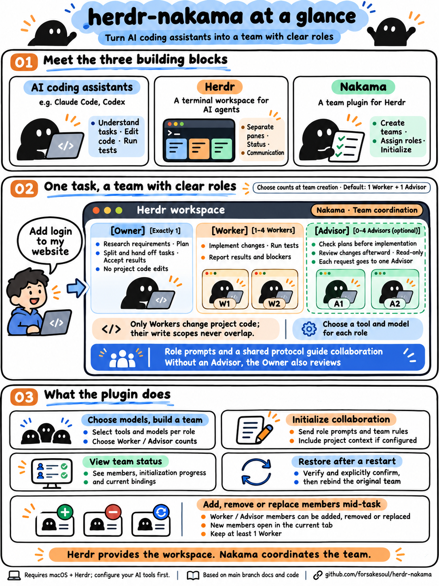

# Nakama

English | [简体中文](README.zh-CN.md) | [日本語](README.ja.md)

A **native [Herdr](https://herdr.dev) plugin** that creates, initializes and restores three-role coding-agent teams (Owner / Worker / Advisor). Written in Go using only the standard library.

https://github.com/user-attachments/assets/4e2de426-f405-45f0-b893-26a8cbc19702

▶ 97-second usage video · [中文版](https://github.com/user-attachments/assets/7ae62131-8042-434e-93c7-6c0ac5361ce0) · [Project page](https://forsakesoul.github.io/herdr-nakama/)

## Nakama at a glance



Each role runs in a separate Herdr pane; role responsibilities are defined by prompts and a shared collaboration protocol. See below for operating instructions and recovery conditions.

## Why "Nakama"

*Nakama* (仲間) is the word Monkey D. Luffy uses for his crew in *One Piece*: not staff or tools, but companions who each own a part of the voyage and trust the others with theirs. That is the shape of the team this plugin builds:

- **Owner — the captain.** Sets the course: investigates, freezes the handoff, accepts the result. Never writes project code.
- **Worker — the crew at work.** The only one who changes code, and reports back when done, blocked or running out of context.
- **Advisor — the navigator.** Optional; checks the plan and reviews the diff independently.

Each nakama sails in its own pane with its own engine, and the shared protocol is how they talk: frozen handoffs, NOTICEs, nobody answering for someone else. When a storm — a computer or Herdr restart — scatters the crew, `nakama rebind` finds every member again, like a Vivre Card pointing home: the same team, not a new one.

The name is a tribute, not an affiliation: this project is not associated with *One Piece*, Eiichiro Oda, Shueisha or Toei Animation.

## Quick start

```sh
# 1. Install (runs the build declared in the manifest). For local development use: go build … && herdr plugin link "$PWD" --enabled
herdr plugin install forsakesoul/herdr-nakama
# 2. Private config: create from config.example.json only if missing (0600), then fill in pi_provider / cc_env_file as needed (private, never commit)
cfg="$(herdr plugin config-dir forsakesoul.nakama)/config.json"
[ -e "$cfg" ] || (umask 077 && mkdir -p "${cfg%/*}" && curl -fsSL https://raw.githubusercontent.com/forsakesoul/herdr-nakama/main/config.example.json -o "$cfg.tmp" && mv "$cfg.tmp" "$cfg")
# 3. Bind keys (append to ~/.config/herdr/config.toml), then reload
herdr server reload-config
```

Key binding example (`config.toml`):

```toml
[[keys.command]]
key = "prefix+u"
type = "plugin_action"
command = "forsakesoul.nakama.pick"
description = "nakama: pick engines and create a team anchored at the current pane"

[[keys.command]]
key = "prefix+i"
type = "plugin_action"
command = "forsakesoul.nakama.init"
description = "nakama: init (initialize the team of the current anchor)"
```

Press `prefix+u` in the target pane to open the engine picker (overlay): choose the Owner engine, then the Worker engine, then the number of Workers (1–4), then the Advisor engine and, only when the Advisor is not `none`, the number of Advisors (1–4) (Enter takes the default; you may type an `engine_map` shorthand or a full `<launcher>/<model>[:effort]`; Advisor accepts `none`). After you confirm the summary, a team is created anchored at the pane that was focused when you pressed the key. `Ctrl-C` cancels (nothing is created before confirmation). When the pane is a team's anchor or one of its role panes, the picker shows that team's management menu instead (add, remove or replace Workers / Advisors, clean task directories — see "Changing roles mid-task"). The engine of an instance on the team stays frozen; changing the model means replacing the instance. The creation flow only creates: if any team (including a half-built one) appears on that pane while you are confirming, it refuses — no recovery, no takeover. A signal received during creation lets the in-flight operation persist, then exits non-zero instead of staying on the result page. Once the agents are up, press `prefix+i` to initialize; inspect results with `herdr plugin action invoke status --plugin forsakesoul.nakama` or `herdr plugin log list --plugin forsakesoul.nakama`.

> The `up` action keeps its original behavior (create a team from `default_profile`, or pass `--owner/--worker/--advisor` on the CLI) and is also used to resume half-built teams. `herdr plugin action invoke up/init/pick` from a shell does not carry the caller's pane and uses the pane currently focused in the UI as the anchor, so trigger `pick` / `up` / `init` via key bindings (or while the target pane has focus).

## Requirements

- macOS
- Go toolchain (to build the binary; go.mod declares 1.24), `git`
- No Ruby / YAML / jq (shared protocol and role prompts are `prompts/<lang>/*.md`)

## Layout

```
herdr-plugin.toml       manifest (actions: up / init / status / rebind / pick; pane: picker)
cmd/nakama/      implementation (package main: config / engine / state / lock / identity / prompts / team …)
bin/nakama       build output (not committed, see below)
prompts/{en,zh,ja}/      protocol.md + owner.md / worker.md / advisor.md per language
config.example.json     example config (no personal provider / credentials)
cmd/nakama/*_test.go  go test (the test binary acts as a fake herdr and records argv as JSON lines)
tests/fixtures/         real Herdr 0.9.3 output (sanitized)
```

## Build, install / link

The manifest's `[[build]]` only runs on `herdr plugin install`; `herdr plugin link` only registers and does **not build** (Herdr 0.9.3 `plugin.rs`). Run the same build command manually before linking locally:

```sh
go build -trimpath -o bin/nakama ./cmd/nakama
herdr plugin link /path/to/nakama
herdr plugin action list --plugin forsakesoul.nakama
```

`up` / `init` require a pane context (`contexts = ["pane"]`); `status` is global and read-only.

## Configuration

Config directory: `$HERDR_PLUGIN_CONFIG_DIR` (injected by Herdr), otherwise `${XDG_CONFIG_HOME:-$HOME/.config}/nakama`.
File: `config.json`. **Never commit real providers / paths / credentials.**

```json
{
  "default_profile": {
    "owner": "sol",
    "worker": "ds",
    "advisor": "none",
    "engine_map": { "sol": "codex/<model>:high", "ds": { "owner": "pi/<model>:low", "worker": "pi/<model>:low", "advisor": "pi/<model>:high" } },
    "cc_env_file": ""
  },
  "projects": {
    "<repo-name>": { "prefix": "<short>", "context_file": "/abs/project-context.md", "trigger": ";xx.ctx" }
  }
}
```

- **Language**: CLI output and agent prompts follow `NAKAMA_LANG=en|zh|ja`, otherwise `LC_ALL` / `LC_MESSAGES` / `LANG` (`zh*`, `ja*`), otherwise English. The variable is read by the plugin process, so set it in the environment Herdr is started from. Use the same language for `up` and `init`: prompts differ per language, so switching in between is refused as a protocol hash drift.
- Precedence: CLI > `default_profile` > built-in neutral defaults (missing config is an error; no personal provider is built in).
- Engine syntax: `<launcher>/<model>[:effort]`, or an `engine_map` shorthand.
- `cc` without a model defaults to `claude-opus-5-5` + `medium` (i.e. `cc --model claude-opus-5-5 --effort medium`); with a model but no effort, `--effort` is omitted and Claude's own default applies.
- **provider**: the provider for `pi` roles comes from `default_profile.pi_provider` (private, never commit); if missing, `up` refuses before any split.
- **`ccenv` launcher**: sources an env file in the pane (e.g. setting `ANTHROPIC_BASE_URL` to point at your own gateway), then starts `cc --model <model>`; `model` is required and effort is not accepted. `default_profile.cc_env_file` must point to a regular readable file on this machine; it is checked before `up` (`-f` and `-r`, content is never read or printed), and directories are rejected. If sourcing fails (including a non-zero `return`), the non-zero status is kept and `cc` is not started. The path appears in the **command text of the corresponding panes** (a path is not a secret); the env file's **content** is never put into commands / state / prompts / logs.
- The `projects` table only **references** context file paths and never copies their content; `init` stops if a file is missing or unreadable.
- Before `init`, the current sha256 of `protocol.md` and the context file must equal the recorded values; on drift it refuses (asking you to `up` a new team) and never rewrites the hash.

### Everyday Claude teams

Based on the [Claude model selection guide](https://claude.dev/blog/which-claude-model-should-you-build-with/) (2026-11-09), keep Owners and Advisors on Opus / medium for design decisions and review. This project's preference is Haiku / medium for routine Workers. The guide recommends Sonnet for scoped coding; starting on Haiku here still requires full verification, with Sonnet / Opus assessed before creating a team for complex work.

Merge `engine_map.claude` from `config.example.json` into the Herdr plugin config described above. In the target pane press `prefix+u`, enter `claude` for Owner / Worker / Advisor and confirm the summary to create the team. Check the launches, then press `prefix+i` to initialize. Use the plugin picker to keep the config and state directories consistent.

This optional preset leaves existing role defaults and private config untouched. `cc` remains Opus 5.5 / medium; the Worker resolves to `cc/haiku:medium`. The `haiku` alias follows local Claude Code, so check the actual model and effort after launch. Enter `none` for Advisor without independent review. For a known harder task, enter `cc/sonnet:medium` or `cc/opus:medium` for Worker. `ccenv` still rejects effort; verify gateway and Pi models, parameters and availability against the actual provider.

Follow the [shared protocol's Claude rules](prompts/en/protocol.md) for failure verification, model escalation and adjustment authorization. Instances on a team keep their frozen engines; when adjustment is needed, hand off at a safe stop and replace that role instance (see "Changing roles mid-task"), or create a team in a new pane under that protocol.

Changing shared protocol content changes `protocol_version` for that language. This version changes `protocol.md`, so teams created before it are refused at init / add / swap and must be recreated. If an old team's hash does not match at initialization, create a new team rather than rewriting state to bypass the check. Existing role contexts are not refreshed automatically.

## Usage

```sh
nakama up [--owner E] [--worker E] [--workers N] [--advisor E|none] [--advisors N] [--pane P] [--cwd C]
nakama init --team <id>
nakama status [--team <id>]
nakama rebind --team <id> [--preflight | --discard-pending] [--confirm-session <O1|W1|A1|anchor>=<session>]... [--confirm-anchor <terminal>]
nakama add --team <id> [--role worker|advisor] [--engine E]
nakama drop --team <id> [--role worker|advisor] [--instance N]
nakama swap --team <id> --role worker|advisor [--instance N] [--engine E]
nakama clean [--team <id>] [--task <task_id>]... [--all] [--yes] [--force]
```

- New team names: `<project short name ≤8>_<12hex>`, or `task_` when no project matches. The suffix mixes a nanosecond timestamp with 6 bytes of cryptographic randomness and takes the first 6 bytes of its SHA-256, keeping a fixed format that external tools can recognize. Role names are `<prefix>_design/_execute/_advisor`, full name ≤32; existing teams keep their names.
- The anchor pane/cwd come from the injected context (`HERDR_PLUGIN_CONTEXT_JSON` / `HERDR_PANE_ID`) and are verified read-only with `herdr pane get/current`; **the plugin root `$PWD` is never used as the project directory** — if it cannot be determined, it refuses.
- Every Herdr call goes through `HERDR_BIN_PATH` (default `herdr`) with argv passed per argument — no eval, no shell concatenation.
- `split` always passes `--pane/--cwd/--no-focus` explicitly.
- If a role stops at an authorization/trust dialog after launch, `up` waits for you to approve it in that pane; each role's capture has a single wait limit `NAKAMA_START_WAIT_SECONDS` (default 600 s), and no input is sent while waiting.
- The `init` anchor may be any role pane of a team: when a role pane is focused, the team is found by pane, and the caller is first verified to still be that team's role instance (read-only, refused before any prompt/rename). If multiple teams match, it errors and requires `--team`. `up` still decides existing teams by the anchor pane only; `pick` opens the team's management menu from the anchor or any role pane.

## Changing roles mid-task

After a team is initialized you can add, remove or replace Workers / Advisors, including a stuck one. The Owner cannot be replaced. A team holds one Owner, 1–4 Workers and 0–4 Advisors (default 1 Worker + 1 Advisor); these limits apply to members at the same time, not to instance numbers. When a kind has more than one member, `swap` and `drop` require `--instance N`. New panes are always split inside the anchor's own tab; if that cannot be verified the operation stops, and no tab or window is created.

- **Entry point**: press `prefix+u` in the anchor or any role pane; for an existing team it shows a management menu (`a` add an Advisor, `n` add a Worker, `x` remove an Advisor, `r` remove a Worker (never the last one), `v` replace an Advisor, `w` replace a Worker, `c` clean task directories; when a kind has several members you type a member key such as `W2`, while the CLI `--instance` takes the number, e.g. `2`). Pick the engine and confirm. The CLI equivalents are `nakama add / drop / swap --team <id>`.
- **Two steps**: `add` / `swap` only create the pane and launch the new instance. After checking its model and permissions, press `prefix+i`: `init` initializes the new role, then delivers one `[TEAM_UPDATE]` (the latest mapping plus that role's new division of work) to each other role on the team. `drop` has no new instance and delivers right away.
- **Only idle roles are notified**: `[TEAM_UPDATE]` goes only to roles whose identity verifies and that are idle/done. A busy or dialog-blocked role keeps a pending flag (`status` shows `team_update=pending`); press `prefix+i` again once it is idle.
- **Old instances**: a replaced or removed instance is recorded under `retired` in the state. Its pane is not closed or renamed and receives no further input from the plugin. Before replacing a Worker, make sure the old one has stopped writing, then deal with that pane yourself.
- **Instance numbers are never reused**: new instances are `W2`, `A2`…, named `<prefix>_execute2`, `<prefix>_advisor2`…; the first instance keeps the original name.
- **Preconditions**: the team is `initialized`, has no unconfirmed side effect and no unfinished rebind, and the hashes of `protocol.md` and the context file are unchanged. A team created before a protocol change cannot be changed; create a new team.
- **Recovery**: if a change fails midway the team stays at `phase=changing` and `init` refuses; check, then rerun the same command or `up` to finish it.

## Task directory and cleanup

A newly created team has a task directory `<project dir>/.nakama/<team id>/`; its path is recorded in the state and written into every role's init prompt. `.nakama/.gitignore` contains `*`, so the whole directory stays out of `git status` and diffs.

- **Purpose**: the Owner creates a `<task_id>/` subdirectory per business task; handoff packages, NOTICEs and the Advisor's conclusions are each written as one file (for example `op_x_h1.md`, `W1-003.md`, `A1-002.md`) and never modified afterwards. Prompts between roles carry only the message header and the file path; writing a file is not delivery, the NOTICE must still be sent. A role that joins or is replaced mid-task reads the latest handoff from here. See the [shared protocol](prompts/en/protocol.md) for the rules.
- **No automatic cleanup**: finishing a task is not authorization to delete. The Owner reports the directory path once at delivery, and runs the cleanup command given in its prompt only after you explicitly say it may be deleted.
- **Cleaning it yourself**: `c` in the management menu, or `nakama clean`. Without a selection it lists every task directory (file count, size, last modified) and, in a terminal, lets you pick by number and confirm; `--team <id> --task <task_id>` or `--all` select directly, and a non-interactive run needs `--yes`.
- **Safeguards**: only direct subdirectories of the task directory recorded in the state are deleted, and symlinks are not followed; while that team's Worker or Advisor (including replaced instances) is working/blocked, or its state cannot be confirmed, it refuses by default, and deletes only with `--force`. Whether requests are settled is judged by the Owner under the protocol; the plugin cannot know.
- **Older teams**: teams created before this version have no task directory and keep inlining message bodies.

## State and safety

- State: `$HERDR_PLUGIN_STATE_DIR/teams/<safe-id>.json` (default `${XDG_STATE_HOME:-$HOME/.local/state}/nakama`); directory 0700, files 0600, atomic replace via a temp file in the same directory + `os.Rename`; JSON is only parsed, never executed; missing required fields / null are always invalid — Go zero values never pass as valid.
- Locks: `mkdir` locks (not flock: auto-release on process exit would break "stale locks are never taken over"). Lock order is fixed anchor → team; a new team holds the team lock before publishing discoverable state until the transaction ends, and every write to an existing team uses the same team lock. **Stale locks are never taken over automatically** — it errors and asks for manual inspection. State and pending are re-read inside the lock before deciding; only the exact paths acquired by this process are released.
- Instance identity: after each role launches / is verified, `terminal|pane|kind|session` is persisted; before `init` / re-entry / `rename` / `prompt` it is re-checked with `agent get`, and a missing or drifted pane/identity field → refuse. Identity comparison has a single implementation comparing terminal/pane/kind/session in full (empty ↔ non-empty session also counts as drift). For manual launchers (`cc`/`ccenv`/`pi`), before `rename` the pane's current instance must match the launch observation — later occupants are never renamed; after `rename` the full fingerprint is checked again against the same baseline (launch observation or frozen identity), and only then is it frozen and prompting allowed (`rename` cannot be undone; on drift the one `rename` already done remains).
- Side-effect ordering: `pending` is written before every `split`/`pane run`/`rename`/`prompt` and updated afterwards; a successful `split` persists the pane immediately. Re-entry verifies first; `UNKNOWN` stops without resending. Only "`agent_pane_busy` before launch" has bounded retries.
- Initialization that hit `timeout`/`agent_prompt_stalled` is marked "delivered, unconfirmed", and `status` points you to a manual `get/read`.
- During launch capture, every observation (including the first) that is `blocked` (authorization/trust dialog) or `unknown` is re-observed within the same wait budget until it leaves those states, then frozen; `start` returning `agent_not_ready` (name reserved) enters the same wait. The budget is `NAKAMA_START_WAIT_SECONDS` per capture (default 600 s) and is not reset by switching between `unknown`/`blocked`; a timeout is treated as a launch failure and reported as an authorization-wait timeout. While waiting it only observes and never sends input; each role is notified once. cc/ccenv/pi waiting time does not count toward the `NAKAMA_START_POLL_TRIES` session polling window.
- When `init`'s `prompt` returns `agent_blocked`, the input was not sent: pending is cleared and it exits non-zero; handle the dialog and press `prefix+i` (or run `init`) again. This is not UNKNOWN.
- For manual launchers (cc/ccenv/pi) the session is reported by a SessionStart hook only after the process is recognized: the launch observation waits for the session within the same bounded polling (`NAKAMA_START_POLL_TRIES`) before persisting, so the first freeze does not treat empty → non-empty as drift; if it is never reported it is recorded as empty.
- Roles frozen with an empty session (codex reports its session only after the first prompt): on `init` re-entry, an observed non-empty session may be filled into the identity one-way (terminal/pane/kind must be identical); any later change is drift. This exception applies only to re-entering roles that are inited and not stale; stale roles are never cleared automatically and need manual handling (`up` a new team). Known limit: replacement by a new instance in the same terminal with the same kind before the fill-in cannot be distinguished.
- After SIGHUP/SIGINT/SIGTERM, the one Herdr operation that already passed the dispatch checkpoint completes and is persisted, and no new side effect starts; the command exits non-zero and locks are released on the normal exit path. SIGKILL cannot be handled; stale locks fail closed per "never taken over" and must be removed after manual inspection.
- `up` re-entry checks the protocol/context hash only on the `starting` path (which performs new writes); the launched/initialized paths add no Herdr writes and `init` checks the hash.
- Never closes or renames the user's existing panes; never takes over running old teams.

## Restoring teams after a computer or Herdr restart

**What happens.** After Herdr (or the computer) restarts, each role pane's `pane_id` and kind usually stay the same, but every `terminal_id` changes (including the anchor's).
Task names may be cleared, or auto-renamed by an external tool (Bridge) to `<project slug>-<terminal digest>`. The claude conversation is usually still the same one; a codex session only appears after its first prompt.
`status` still shows the roles, but the terminal and name checks of `init` / `prompt` refuse, so the team is unusable for the runtime.

**What to do.**
1. Run a read-only preflight first (zero writes): `nakama rebind --team <id> --preflight`. It prints, per role and anchor, `terminal old → new` and the differences in session and task name.
2. Add the confirmation arguments from the output and run: `nakama rebind --team <id> --confirm-anchor <new anchor terminal> [--confirm-session <O1|W1|A1|anchor>=<session>]...`.
   - `--confirm-session` is only for roles whose recorded session is empty (e.g. codex frozen before its first prompt); the value must equal the non-empty session observed now.
   - `--confirm-anchor` is only for shell anchors without an identity; the value must equal the new terminal observed now.
   - Roles with a non-empty recorded session accept no confirmation override: the observation must equal the record.
3. If no rebind is needed (identity and names already match), it prints `no rebind needed` and writes no state; repeated runs are a full no-op, without incrementing `team_rev` or adding audit entries.

**Refusal conditions (always zero renames, zero state writes).** The team is not `initialized`, has a pending operation, or any role is stale or uninitialized; a pane is unreadable;
a pane's workspace/tab/cwd differs from the record; kind changed; the observed session is empty or differs from the record; the task name is neither empty nor the exact Bridge auto-name (possibly taken by someone else);
the target task name is taken by another pane; a confirmation value differs from the observation or targets a field that needs no confirmation. On refusal only the candidate differences are printed; they are never written as a new identity.

**Semantics: acceptance, not proof.** Same pane + same kind + non-empty session only means the user explicitly accepts "the same conversation resumed in a new terminal"; it does not prove the same process or credentials.
The CLI cannot prove the Herdr server namespace; anchor evidence is the continuity of workspace/tab/cwd from `pane get` plus the pane id.

**Execution and interruption.** After preflight passes, the complete plan (old/new identities, rename steps) is persisted as `rebind_pending`, then per role: re-read before renaming → `agent rename` → verify both by pane and by task name,
persisting each step's result. Only after all verifications pass are the current identities and anchor terminal (and `pane_terminal`) committed at once, `team_rev` incremented, pending cleared and an audit record appended. The audit (`rebinds`) records the operation id, time, result (`committed` or `discarded`), confirmation method, each step's full old/new identity (including the session before and after confirmation), and the anchor's old/new terminal; when the anchor has an identity, its full old/new identity is also recorded. No output excerpts are recorded.
`launch_identity` is kept as launch history and no longer used for current checks. On failure, signal or unknown result midway, pending and completed steps are kept and it exits non-zero — **no blind rollback**.
Before execution and before commit the whole team is re-verified: stable-team conditions, each planned role's pane context (workspace/tab/cwd) and full identity, and the anchor's context and identity (also when the anchor is unchanged). Completed steps are re-verified too; they just don't rename again. Before any execution or resumption starts, the current observation must equal the planned new identity; if it is still the old identity it stops (preflight again or wait) with zero new renames, and partially renamed results never count as success. Any drift stops before any new rename, keeping the plan and the current identity. If the persisted plan is inconsistent with the team record across fields (missing or duplicated steps, nonexistent roles, different old identities, unconfirmed session changes, etc.), it is treated as corrupt: execution and commit are refused and no defaults are filled in.

**Manual checks after partial failure.**
1. Use `herdr agent get <pane>` and `herdr agent get <name>` to check each role's pane, terminal, kind, session and task name.
2. If reconciliation can continue, re-run `rebind --team <id>` with the original confirmation arguments (they may only echo values already confirmed in the plan; different values are refused).
3. If identities no longer match the plan (e.g. another restart happened), abandon it with `rebind --team <id> --discard-pending`; identity records are unchanged and completed renames stay in Herdr. Then run `--preflight` again before executing.
   Discarding is safe because the plan changes no current identity before commit; the next preflight re-evaluates from current observations.

**Racing with Bridge.** Herdr's rename has no compare-and-swap semantics, so Bridge auto-naming between read and rename cannot be ruled out mathematically.
On detected drift it stops and keeps the plan; the plugin does not chase or modify Bridge. Success does not mean the name never changes; later `init` / `prompt` still apply strict checks.

**State compatibility.** This version writes `schema_version: 4`: roles are keyed by member (`O1`, `W1`, `W2`, `A1`…); schema 1–3 state is converted in memory and written back as schema 4 only on the first save. Schema 2 added `rebind_pending` and `rebinds` (audit), schema 3 adds `task_dir`, `retired` and the per-role `team_update_pending`. Older versions refuse any higher schema,
so state is never overwritten with new fields lost; to go back to an older version, first make sure no plan is pending and handle the state file yourself. Schemas 1–3 can still be read and are upgraded to 4 on the first real save.

**Never automatic.** `init` and `up` never rebind; when `init` detects a "candidate with only terminal or name changes" it only hints that `an explicit rebind --team <id> may be needed`,
without marking stale or writing state. `status` is read-only, observes by recorded pane, prints `binding=bound|candidate|unverified`, and distinguishes the lifecycle `status` from whether the binding is valid. `bound` also requires the current task name to equal the recorded role name; a foreign or empty name gives at most `unverified`. `candidate` is only a candidate (same pane and kind, terminal or name changed) and does not guarantee `rebind` passes preflight — check with `--preflight` first.

## Protocol source

`prompts/<lang>/{protocol,owner,worker,advisor}.md` are the single source of truth for the shared protocol and role prompts and are read at runtime; `protocol_version` is the sha256 of the selected language's `protocol.md`. The Chinese text is the original; English and Japanese are translations that must keep the same `<!-- … -->` markers (checked by tests). Downstream projects reusing these templates should sync from this directory and verify the source version themselves. Authorization for manual Skills is written in the project context file or the request; the protocol itself ships no Skill allowlist.

For architecture tasks, the `architecture` Skill (user-defined, not provided by the plugin) is read per role when installed; otherwise the original handoff contract continues and the gap is noted. The plugin does not install Skills, change role division or spawn teams. Template changes do not refresh existing role contexts; old teams that have not finished initialization remain protected by the original protocol-hash drift check, which is never bypassed by clearing state.

When the user asks any role to compact its context, the automatic compaction branch of an installed [`long-task`](https://github.com/forsakesoul/awesome-skills/tree/main/long-task) Skill (a user-defined compaction Skill, not bundled with the plugin) is used; this plugin only keeps the rules connecting it to existing duties, pause/resume authorization and request state. Background control targets only the caller's own session; when not installed or unsupported by the control plane, recovery information is kept and the gap reported.

## Tests

```sh
gofmt -l .
go vet ./...
go test ./...
go build -trimpath -o bin/nakama ./cmd/nakama
```

The fixtures `tests/fixtures/agent_get.json` / `pane_get_shell.json` come from real Herdr 0.9.3 output (sanitized): plain shell panes also have a `terminal_id`; in `agent get`, the `agent` field is the kind and `agent_session.value` is the session.

`plugin_context_invoke.json` is the `context` from a real `plugin.action.invoke` response (source-confirmed to equal the injected `HERDR_PLUGIN_CONTEXT_JSON`; the sample comes from the invoke response, not a child-process environment): its `tab_label` / `focused_pane_agent` are per-field overrides from the UI's active tab and differ from the explicitly passed tab/pane, so the program only uses `focused_pane_id`. `agent_start.json` is the stdout of native `agent start` from a real `up` action log (sanitized), kept only as a sample and never parsed.

## Known limitations

- The Herdr server namespace cannot be proven directly from the CLI; anchor evidence uses `terminal_id` continuity from `pane get` (compared at init / for existing teams) instead, and this README documents that boundary.
- There is an unavoidable race window between `rebind` renames and Bridge auto-naming (see "Restoring teams after a computer or Herdr restart"); on drift it stops and keeps the plan.
- `rebind`'s Herdr calls are only verified with the fake herdr harness; the return of `agent rename` and the argument passing of `plugin action invoke` on real Herdr 0.9.3 were not sampled in this version.
- The first freeze of manual launchers (pi/cc/ccenv) requires "terminal_id recorded at split == terminal_id from the first agent get" + "kind equals the expected kind" + "the instance is not named by someone else"; if any fails it stops with UNKNOWN. The only name compatibility is the exact external Bridge auto-name (project directory slug + first 4 hex of SHA-256 of terminal_id): it may be replaced by the role name while the full launch fingerprint still matches; other names, missing launch fingerprints or fingerprint drift are still refused. Timestamps distinguish creation batches; this compatibility keeps auto-naming from blocking init.
- Rebuilding a half-built team only launches when the pane occupancy is `idle` (confirmed `agent_not_found`); `occupied` and `unknown` (get failed / incomplete object) both terminate non-zero before launch.
- The response structure of `agent start` was not sampled and is not relied on for capture; native identity always uses a bounded `agent get`.

## Not yet supported

popup / TUI, `startup` / `events`, several Workers in parallel, replacing the Owner, `sync`, taking over old teams, CI.

## Acknowledgements

- [Herdr](https://herdr.dev) ([herdrdev/herdr](https://github.com/herdrdev/herdr), Apache-2.0) — the terminal multiplexer for coding agents that Nakama plugs into; every pane, agent and rename goes through its CLI.
- [motion-use](https://github.com/leeguooooo/motion-use) (MIT) — used to direct and render the usage video, including its subtitle, text and narration checks.
- [Azure AI Speech](https://azure.microsoft.com/products/ai-services/ai-speech) — neural text-to-speech for the video narration.

## License

[MIT](LICENSE)
