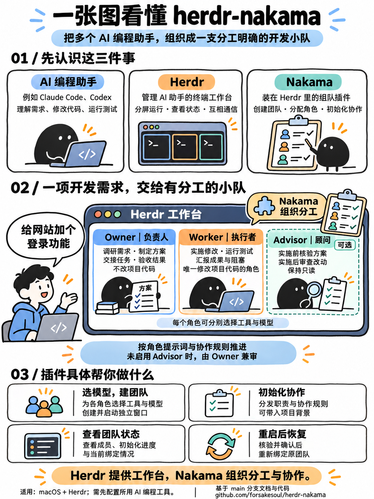

# Nakama

[English](README.md) | 简体中文 | [日本語](README.ja.md)

在 [Herdr](https://herdr.dev) 里创建、初始化和恢复 Owner / Worker / Advisor 三角色编码 agent 编组的**Herdr 原生插件**（Go 实现，仅用标准库）。

https://github.com/user-attachments/assets/25ce3f28-7fe1-4619-8731-c8773cf14a4f

▶ 85 秒使用演示 · [English version](https://github.com/user-attachments/assets/4b663eaa-346a-43d5-8933-d254a7285315) · [项目主页](https://forsakesoul.github.io/herdr-nakama/)

## 一张图看懂 Nakama



图中的“独立窗口”对应 Herdr 的独立 pane；角色分工由提示词和协作协议约定。具体操作与恢复条件见下文。

## 为什么叫 Nakama

*Nakama*（仲間）是《海贼王》里路飞对船员的称呼：不是雇员，也不是工具，而是各自负责一段航程、又把后背交给彼此的伙伴。这正是本插件要组建的团队：

- **Owner：船长。** 定航向：调研、冻结交接包、验收结果，自己不改项目代码。
- **Worker：动手的船员。** 唯一修改代码的人；完成、受阻或上下文快用完时主动回报。
- **Advisor：航海士。** 可选；独立核验方案、审查 diff。

每位伙伴在自己的 pane 里、用自己的引擎航行，共享协议就是他们的沟通方式：冻结交接包、发 NOTICE、谁也不替别人作答。当一场风暴（电脑或 Herdr 重启）把船员吹散时，`nakama rebind` 会像“生命卡”指引方向一样把每个人找回来：还是原来那支船团，而不是重新拉一支。

这个名字是致敬，不代表任何关联：本项目与《海贼王》、尾田荣一郎、集英社及东映动画均无关系。

## 三行上手

```sh
# 1. 安装（会执行 manifest 中的构建）；本地开发改用：go build … && herdr plugin link "$PWD" --enabled
herdr plugin install forsakesoul/herdr-nakama
# 2. 私有配置：仅在不存在时以 config.example.json 为模板生成（0600），再按需填写 pi_provider / cc_env_file（私有，勿入库）
cfg="$(herdr plugin config-dir forsakesoul.nakama)/config.json"
[ -e "$cfg" ] || (umask 077 && mkdir -p "${cfg%/*}" && curl -fsSL https://raw.githubusercontent.com/forsakesoul/herdr-nakama/main/config.example.json -o "$cfg.tmp" && mv "$cfg.tmp" "$cfg")
# 3. 绑定快捷键（追加到 ~/.config/herdr/config.toml）后重载配置
herdr server reload-config
```

快捷键示例（`config.toml`）：

```toml
[[keys.command]]
key = "prefix+u"
type = "plugin_action"
command = "forsakesoul.nakama.pick"
description = "nakama: 选择引擎并以当前 pane 为锚点建组"

[[keys.command]]
key = "prefix+i"
type = "plugin_action"
command = "forsakesoul.nakama.init"
description = "nakama: init（初始化当前 anchor 的编组）"
```

在目标 pane 按 `prefix+u` 弹出引擎选择界面（overlay）：依次选 Owner / Worker / Advisor（回车取默认，可输入 `engine_map` 简写或完整的 `<launcher>/<model>[:effort]`，Advisor 可填 `none`），确认摘要后以按键时聚焦的 pane 为锚点建组；`Ctrl-C` 取消（确认前不会产生任何建组副作用）。该锚点已有编组时只显示现有组与各角色冻结的引擎——不能在原锚点换模型，需要新模型请在新 pane 建组。选择界面只新建：确认期间该 pane 若已出现任何编组（含半组）也一律拒绝，不恢复、不接管；建组执行期间收到信号会让在途操作落盘后直接非零退出，不再停在结果页。核对 agent 起好后按 `prefix+i` 初始化；结果用 `herdr plugin action invoke status --plugin forsakesoul.nakama` 或 `herdr plugin log list --plugin forsakesoul.nakama` 查看。

> `up` action 仍保留原行为（按 `default_profile` 批量建组，或 CLI 传 `--owner/--worker/--advisor`），也用于半组恢复。命令行 `herdr plugin action invoke up/init/pick` 不携带调用方 pane，会以 UI 当前聚焦 pane 为锚点，所以 `pick` / `up` / `init` 请用快捷键（或在目标 pane 获得焦点时触发）。

## 依赖

- macOS
- Go 工具链（构建二进制用，go.mod 声明 1.24）、`git`
- 不引入 Ruby / YAML / jq（共享协议与角色提示词为 `prompts/<lang>/*.md`）

## 目录

```
herdr-plugin.toml       manifest（actions: up / init / status / rebind / pick；pane: picker）
cmd/nakama/      实现（package main：config / engine / state / lock / identity / prompts / team …）
bin/nakama       构建产物（不入库，见下）
prompts/{en,zh,ja}/      各语言的 protocol.md + owner.md / worker.md / advisor.md
config.example.json     配置示例（不含任何个人 provider / 凭据）
cmd/nakama/*_test.go  go test（测试二进制自身充当假 herdr，记录 argv 为 JSON 行）
tests/fixtures/         真实 Herdr 0.9.3 输出（脱敏）
```

## 构建、安装 / 链接（本仓库不自带安装动作）

清单的 `[[build]]` 只在 `herdr plugin install` 时执行；`herdr plugin link` 只注册、**不构建**（Herdr 0.9.3 `plugin.rs`）。本地 link 前须先手动运行同一条构建命令：

```sh
go build -trimpath -o bin/nakama ./cmd/nakama
herdr plugin link /path/to/nakama
herdr plugin action list --plugin forsakesoul.nakama
```

`up` / `init` 需要 pane 上下文（`contexts = ["pane"]`），`status` 为全局只读。

## 配置

配置目录：`$HERDR_PLUGIN_CONFIG_DIR`（Herdr 注入），否则 `${XDG_CONFIG_HOME:-$HOME/.config}/nakama`。
文件：`config.json`。**不要把真实 provider / 路径 / 凭据提交进仓库**。

```json
{
  "default_profile": {
    "owner": "sol",
    "worker": "ds",
    "advisor": "none",
    "engine_map": { "sol": "codex/<model>:high", "ds": { "owner": "pi/<model>:low", "worker": "pi/<model>:low", "advisor": "pi/<model>:high" } },
    "cc_env_file": ""
  },
  "projects": {
    "<repo-name>": { "prefix": "<short>", "context_file": "/abs/project-context.md", "trigger": ";xx.ctx" }
  }
}
```

- **语言**：CLI 输出与 agent 提示词按 `NAKAMA_LANG=en|zh|ja` 选择，未设置时依次看 `LC_ALL` / `LC_MESSAGES` / `LANG`（`zh*`、`ja*`），否则为英文。该变量由插件进程读取，需设置在启动 Herdr 的环境里。`up` 与 `init` 须使用同一语言：各语言提示词不同，中途切换会被当作 protocol hash 漂移而拒绝。
- 参数优先级：CLI > `default_profile` > 内置中立默认（缺配置则报错，不内置个人 provider）。
- 引擎写法：`<launcher>/<model>[:effort]`，或 `engine_map` 的简写。
- `cc` 不写 model 时默认 `claude-opus-5-5` + `medium`（即 `cc --model claude-opus-5-5 --effort medium`）；写了 model 而未写 effort 时不传 `--effort`，交给 Claude 自己的默认值。
- **provider**：`pi` 角色的 provider 由 `default_profile.pi_provider` 提供（私有，勿入库）；缺则 `up` 在任何 split 之前拒绝。
- **`ccenv` 启动器**：先在 pane 里 `source` 一个 env 文件（例如设置 `ANTHROPIC_BASE_URL` 等指向自建网关），再启动 `cc --model <model>`；`model` 必填、不接受 effort。`default_profile.cc_env_file` 指向本机普通可读文件；`up` 前校验（`-f` 且 `-r`，不读内容、不打印值），目录路径即拒绝。source 失败（含 `return` 非零）时保留非零、不启动 `cc`。启动时该路径会出现在**对应 panes 的命令文本**里（路径不是密钥），env 文件**内容**绝不会被拼入命令/状态/prompt/日志。
- `projects` 表只**引用**上下文文件路径，不复制正文；文件缺失/不可读时 `init` 停止。
- `init` 前核对 `protocol.md` 与上下文文件的当前 sha256 等于记录值；漂移则拒绝（提示重新 `up` 新组），不自动改 hash。

## 用法

```sh
nakama up [--owner E] [--worker E] [--advisor E|none] [--pane P] [--cwd C]
nakama init --team <id>
nakama status [--team <id>]
nakama rebind --team <id> [--preflight | --discard-pending] [--confirm-session <role>=<session>]... [--confirm-anchor <terminal>]
```

- 新组命名：`<项目短名 ≤8>_<12hex>`，未匹配时使用 `task_`；后缀由纳秒时间戳与 6 字节密码学随机数混合，经 SHA-256 取前 6 字节生成，保持外部工具可识别的固定格式。角色名 `<prefix>_design/_execute/_advisor`，全名 ≤32；已有组继续沿用原名。
- 锚点 pane/cwd 取自注入上下文（`HERDR_PLUGIN_CONTEXT_JSON` / `HERDR_PANE_ID`），并用 `herdr pane get/current` 只读核对；**不以插件根 `$PWD` 当项目目录**，无法确定则拒绝。
- 所有 Herdr 调用走 `HERDR_BIN_PATH`（缺省 `herdr`），argv 逐参数，不 eval、不拼 shell。
- `split` 一律显式 `--pane/--cwd/--no-focus`。
- 角色启动后若停在授权/信任对话框，`up` 会等待你在该 pane 完成授权；每个角色的一次取证只有一个等待上限 `NAKAMA_START_WAIT_SECONDS`（缺省 600 秒），等待期间不发送任何输入。
- `init` 的锚点可以是任一编组角色 pane：焦点在角色 pane 时按 pane 找所属编组，并先核验调用者仍是该组的对应角色实例（只读，任何 prompt/rename 前拒绝）；同时命中多个编组时报错，须用 `--team` 指定。`up`/`pick` 仍只按锚点 pane 判断已有编组。

## 状态与安全

- 状态：`$HERDR_PLUGIN_STATE_DIR/teams/<safe-id>.json`（缺省 `${XDG_STATE_HOME:-$HOME/.local/state}/nakama`）；目录 0700、文件 0600、同目录临时文件 + `os.Rename` 原子替换；只解析 JSON，绝不执行；缺必需字段/null 一律视为非法，不用 Go 零值冒充有效。
- 锁：`mkdir` 锁（不用 flock：进程退出自动释放会破坏「遗留锁不自动接管」）；锁序固定 anchor → team，首次建组在发布可发现状态前即持 team 锁并持有到事务结束，已有组的所有写操作用同一把 team 锁；**遗留锁不自动接管**，报错提示人工核对；锁内重读状态与 pending 再决策；只释放本进程取得的完整路径。
- 实例身份：每个角色启动/核验成功后持久化 `terminal|pane|kind|session`；`init`/重入/`rename`/`prompt` 前用 `agent get` 复核，pane/身份字段缺失或漂移 → 拒绝；身份比较只有一个实现，完整比较 terminal/pane/kind/session（session 空与非空之间的变化同样算漂移）。手动启动器（`cc`/`ccenv`/`pi`）`rename` 前确认 pane 当前实例与启动观测一致，不 `rename` 后来占用者；`rename` 后再用同一基准（启动观测或已冻结 identity）核一次完整指纹，通过才冻结并允许 prompt（`rename` 本身无法撤回，漂移时已发生的 1 次 `rename` 会保留）。
- 副作用顺序：每个 `split`/`pane run`/`rename`/`prompt` 前写 `pending`，返回后更新；`split` 成功即落盘 pane。重入先核验；`UNKNOWN` 停止不重发。仅“启动前 `agent_pane_busy`”可有界重试。
- `timeout`/`agent_prompt_stalled` 的初始化标“已投递未确认”，`status` 引导人工 `get/read`。
- 启动取证时，每次观测（含首次）若为 `blocked`（授权/信任对话框）或 `unknown`，都在同一个等待预算内重新观察，直到离开这两种状态才冻结；`start` 返回 `agent_not_ready`（名字已保留）同样进入这一等待。预算为单次取证的 `NAKAMA_START_WAIT_SECONDS`（缺省 600 秒），中途 `unknown`/`blocked` 切换不重置；超时按启动失败处理并说明是授权等待超时。等待期间只观察、不发送输入；每个角色只提示一次。cc/ccenv/pi 在等待期间不计入 `NAKAMA_START_POLL_TRIES` 的 session 轮询窗口。
- `init` 的 `prompt` 返回 `agent_blocked` 时输入未发出，清除 pending 并以非零退出，处理对话框后重按 `prefix+i`（或 `init`）即可；这不是 UNKNOWN。
- 手动启动器（cc/ccenv/pi）的 session 由 SessionStart hook 在进程被识别后才上报：启动观测会在同一有界轮询（`NAKAMA_START_POLL_TRIES`）内等 session 出现再落盘，避免首次冻结把空→非空判为漂移；始终未上报则按空记录。
- 冻结时 session 为空的角色（codex 首次 prompt 后才上报 session）：`init` 重入复核时允许把观测到的非空 session 单向补全进 identity（terminal/pane/kind 必须完全相同），补全后再变化即漂移。该例外只适用于已 inited 且未 stale 的重入角色；已 stale 的角色不会被自动清除，需人工处理（重新 up 新组）。已知上限：补全前被同终端、同 kind 的新实例替换无法区分。
- 收到 SIGHUP/SIGINT/SIGTERM 后，已通过派发检查点的那一个 Herdr 操作会完成并落盘，之后不再开始新的副作用；命令以非零退出，锁由正常退出路径释放；SIGKILL 不可处理，遗留锁按「不自动接管」fail-closed，需人工核对后删除。
- `up` 重入只在 `starting`（会产生新写操作）路径核对 protocol/context hash；launched/initialized 路径不新增 Herdr 写操作，hash 由 `init` 核对。
- 不关闭、不改名用户既有 pane；不接管运行中的旧组。

## 电脑或 Herdr 重启后恢复编组

**会发生什么。** Herdr 重启（或电脑重启）后，各角色 pane 的 `pane_id` 与 kind 通常保持，但 `terminal_id` 会全部改变（锚点也一样），
任务名可能被清空，或被外部工具（Bridge）自动改名为 `<项目 slug>-<terminal 摘要>`。claude 的会话通常仍是同一个；codex 的会话只在首次 prompt 后才出现。
此时 `status` 能看到角色，但 `init` / `prompt` 的 terminal 与名称检查都会拒绝，编组对 runtime 不可用。

**怎么做。**
1. 先只读预检（零写入）：`nakama rebind --team <id> --preflight`。它逐角色、逐锚点输出 `terminal 旧 → 新`、session 与任务名的差异。
2. 按输出补充确认参数后执行：`nakama rebind --team <id> --confirm-anchor <新锚点 terminal> [--confirm-session <role>=<session>]...`。
   - `--confirm-session` 只用于记录 session 为空的角色（例如 codex 首次 prompt 前冻结的），值必须等于本次观测到的非空 session。
   - `--confirm-anchor` 只用于没有 identity 的 shell 锚点，值必须等于本次观测到的新 terminal。
   - 记录 session 非空的角色不接受确认覆盖：观测必须与记录相等。
3. 无需重绑（身份与名称都已一致）时输出 `无需重绑` 且不写状态；重复执行是完整 no-op，不增加 `team_rev`，也不增加审计。

**拒绝条件（全部零 rename、零状态写入）。** 编组不是 `initialized`、存在 pending、任一角色 stale 或未初始化；pane 不可读；
pane 的 workspace/tab/cwd 与记录不一致；kind 变化；观测 session 为空，或与记录不同；任务名既不是空也不是 Bridge 精确自动名（可能是他人占用）；
目标任务名被其它 pane 占用；确认值与观测不一致或指向不需要确认的字段。拒绝时只输出候选差异，不把它写成新 identity。

**语义是接纳，不是证明。** 同 pane + 同 kind + 非空 session 只说明用户显式接纳“同一对话在新 terminal 恢复”，不证明同一进程或凭据。
CLI 无法证明 Herdr server 命名空间；锚点证据是 `pane get` 的 workspace/tab/cwd 连续性与 pane id。

**执行与中断。** 预检通过后先把完整计划（旧/新身份、待改名步骤）落盘为 `rebind_pending`，再逐角色：改名前重读 → `agent rename` → 按 pane 与任务名两向复核，
每步结果落盘。全部复核通过后才一次性提交当前 identity、锚点 terminal（以及 `pane_terminal`），`team_rev` 加一，清除 pending，并追加审计记录。审计（`rebinds`）记录操作 id、时间、结果（`committed` 或 `discarded`）、确认方式、逐步的旧/新完整 identity（含 session 的确认前后值）、锚点的旧/新 terminal；锚点有 identity 时另记其旧/新完整 identity。不记录输出片段。
`launch_identity` 保留为启动历史，不再用于当前校验。中途失败、信号或未知结果时保留 pending 与已完成的步骤，非零退出，**不做盲回滚**。
执行前与提交前都会对整组重新复核：稳定组条件、每个计划角色的 pane 上下文（workspace/tab/cwd）与完整身份、锚点的上下文与身份（锚点未变化时同样复核）。已完成的步骤也会复核，它们只是不重发改名。任何执行或恢复开始前，当前观测都必须等于计划的新身份；仍为旧身份时停止（需重新预检或等待），零新增 rename，不把已改名的部分结果当成功。任何漂移都在新增 rename 之前停止，计划与当前 identity 保留。持久化计划若与编组记录跨字段不一致（步骤缺失或重复、角色不存在、旧身份不同、未经确认的 session 变化等），视为损坏：拒绝执行与提交，不补默认值。

**部分失败后的人工核对。**
1. `herdr agent get <pane>` 与 `herdr agent get <name>` 核对每个角色的 pane、terminal、kind、session 与任务名。
2. 若对账可以继续，直接重新执行 `rebind --team <id>` 并带上原确认参数（只能回显计划中已确认的值，不同则拒绝）。
3. 若身份已不再对应计划（例如又发生了一次重启），用 `rebind --team <id> --discard-pending` 放弃计划，身份记录不变；已完成的改名保留在 Herdr 中。随后重新 `--preflight` 再执行。
   放弃是安全的，因为计划在提交前不改变任何当前 identity；再次预检会基于当前观测重新判断。

**与 Bridge 的竞争。** Herdr 的 rename 没有比较并交换语义，读取与改名之间无法从数学上排除 Bridge 的自动命名。
检测到漂移时停止，计划保留；插件不追逐、不修改 Bridge。成功不代表名称永久不变，之后的 `init` / `prompt` 仍按严格规则检查。

**状态兼容。** 本版本写出 `schema_version: 2`，新增 `rebind_pending` 与 `rebinds`（审计）。旧版本只接受 schema 1，读到 2 即拒绝，
因此不会在丢失新字段的情况下覆盖状态；要回到旧版本，需先确认没有未完成的计划并自行处理状态文件。schema 1 仍可读取，保存后升级为 2。

**不会自动发生。** `init` 与 `up` 不执行重绑；`init` 在检测到“仅 terminal 或名称变化的候选”时只提示 `可能需要显式 rebind --team <id>`，
不标 stale、不写状态。`status` 只读，按记录 pane 观测，输出 `binding=bound|candidate|unverified`，并区分生命周期 `status` 与绑定是否有效。`bound` 还要求当前任务名等于记录的角色名；名称为他人名或为空时至多 `unverified`。`candidate` 只是候选（同 pane 与 kind，terminal 或名称已变），不保证 `rebind` 能通过预检，需先 `--preflight` 核对。

## 协议来源

`prompts/<lang>/{protocol,owner,worker,advisor}.md` 是共享协议与角色正文的唯一权威源，运行时直接读取；`protocol_version` 为所选语言 `protocol.md` 的 sha256。中文为原文，英文与日文为译文，须保持相同的 `<!-- … -->` 标记（由测试检查）。下游如需复用这些模板，应从本目录同步并自行校验来源版本。手动 Skill 的授权写在项目上下文文件或需求里，协议本身不预置任何 Skill 名单。

架构任务在已安装 `architecture` Skill 时按当前角色读取，未安装则按原交接契约继续并注明缺口。插件不自动安装 Skill、不改变角色分工或派生团队。模板变更不会刷新已有角色上下文；未完成初始化的旧组仍受原协议 hash 漂移检查保护，不清除状态绕过。

用户主动要求任一角色压缩时，使用已安装 `long-task` Skill 的自动压缩分支；本插件只保留与既有职责、暂停/恢复授权及请求状态的衔接规则。后台控制只针对调用者自己的会话，未安装或控制面不支持时保留恢复信息并报告缺口。

## 测试

```sh
gofmt -l .
go vet ./...
go test ./...
go build -trimpath -o bin/nakama ./cmd/nakama
```

夹具 `tests/fixtures/agent_get.json` / `pane_get_shell.json` 取自真实 Herdr 0.9.3 输出（脱敏）：普通 shell pane 也有 `terminal_id`，`agent get` 的 `agent` 字段即 kind、`agent_session.value` 即 session。

`plugin_context_invoke.json` 取自真实 `plugin.action.invoke` 回包里的 `context`（源码确认与注入的 `HERDR_PLUGIN_CONTEXT_JSON` 同值；样本来源是 invoke 回包，非子进程环境）：其中 `tab_label` / `focused_pane_agent` 来自 UI 当前活跃 tab 的逐字段覆盖，与显式传入的 tab/pane 不一致，程序只用 `focused_pane_id`。`agent_start.json` 取自真实 `up` 的 action log 里 native `agent start` 的 stdout（脱敏），仅留作样本，不被解析。

## 已知限制

- Herdr server 命名空间无法由 CLI 直接证明；锚点证据以 `pane get` 的 `terminal_id` 连续性（init/已有组时比对）代替，README 如实记录该边界。
- `rebind` 的改名与 Bridge 自动命名之间存在无法消除的竞争窗口（见「电脑或 Herdr 重启后恢复编组」）；漂移时停止并保留计划。
- `rebind` 的 Herdr 调用只经假 herdr harness 验证；真实 Herdr 0.9.3 上 `agent rename` 的返回与 `plugin action invoke` 传参方式未在本版本采样。
- 手动启动器（pi/cc/ccenv）首次冻结要求「split 时记录的 terminal_id == 首次 agent get 的 terminal_id」+「kind 等于期望种类」+「实例未被他人具名」；任一不满足即 UNKNOWN 停止。唯一名称兼容项是外部 Bridge 的精确自动名（项目目录 slug + terminal_id 的 SHA-256 前 4 位）：完整启动指纹仍一致时允许替换为角色名；其他名字、缺少启动指纹或指纹漂移仍拒绝。时间戳用于区分创建批次，这项兼容用于避免自动命名阻断 init。
- 半组补建只在 pane 占用状态为 `idle`（确证 `agent_not_found`）时启动；`occupied` 与 `unknown`（get 失败/对象不完整）都在启动前非零终止。
- `agent start` 的返回体结构未采样，不依赖其取证；native 身份一律用有界 `agent get`。

## 暂不支持

popup / TUI、`startup` / `events`、`add` / `drop` / `swap` / `sync`、接管旧组、CI。

## 致谢

- [Herdr](https://herdr.dev)（[herdrdev/herdr](https://github.com/herdrdev/herdr)，Apache-2.0）：Nakama 所运行的编码 agent 终端复用器，所有 pane、agent 与改名操作都经由它的 CLI 完成。
- [motion-use](https://github.com/leeguooooo/motion-use)（MIT）：用于编排和渲染使用演示视频，包括字幕、画面文字和旁白的检查。
- [Azure AI 语音](https://azure.microsoft.com/products/ai-services/ai-speech)：视频旁白的神经网络语音合成。

## 许可证

[MIT](LICENSE)
